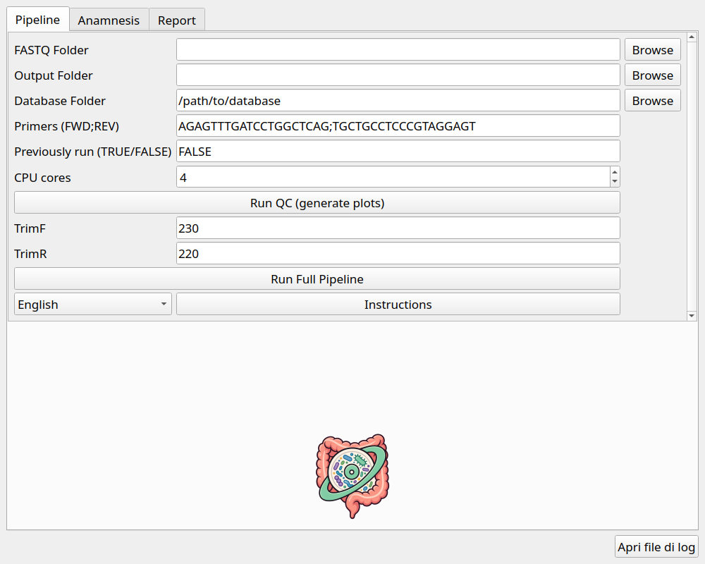
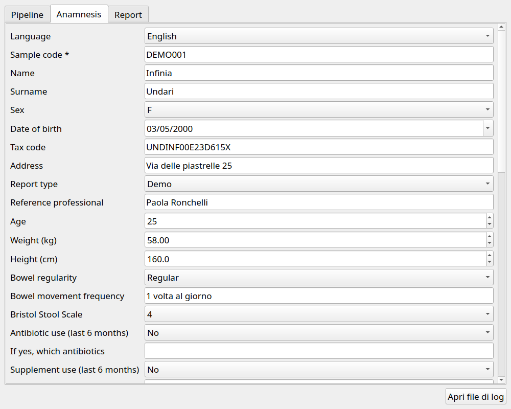
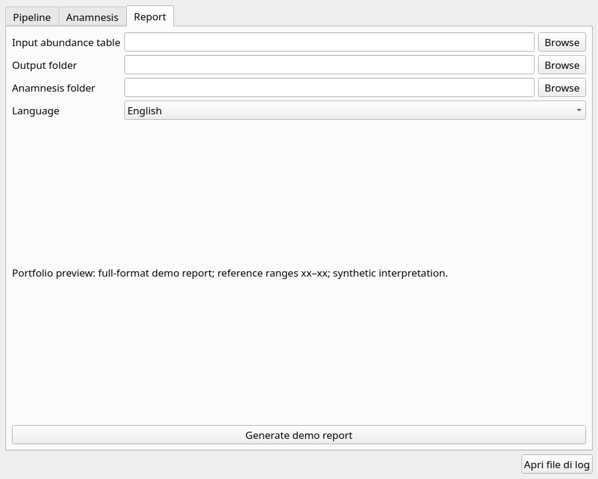
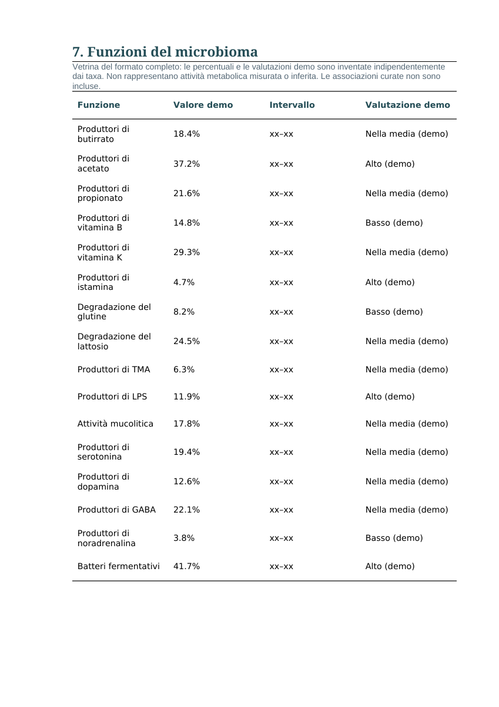

# IrisBiome — Microbiome Analysis Suite


**Portfolio Preview · v0.9.0.dev0 · Active Development**

A desktop application for **16S rRNA microbiome data analysis**, integrating a Python/PyQt5 graphical interface, an R/DADA2 bioinformatics pipeline, and automated DOCX/XLSX reporting.

## Overview

IrisBiome is a bioinformatics software suite designed to streamline the analysis of gut microbiome data obtained from paired-end 16S rRNA amplicon sequencing.

The application integrates sequencing data processing, taxonomic profiling, sample metadata management, data visualization, and automated report generation into a unified workflow.

The public repository provides the DADA2-based analysis pipeline and a functional demonstration reporting module. The complete version, which include the biological interpretation of the results, is maintained separately.

### Project Background

IrisBiome originates from a bioinformatics software project **developed, tested, and used in a real-world professional environment** for gut microbiome analysis.

The original software was developed to automate the workflow from raw sequencing data processing to the generation of structured analytical reports. It was successfully tested and used in practice, providing an integrated solution for microbiome data processing and reporting.

This repository the publicly available portfolio version of this work.


### Explore the Demo

**No installation required to explore example outputs:**

- [Italian PDF preview](docs/IrisBiome_demo_report.pdf)
- [English PDF preview](docs/IrisBiome_demo_report_en.pdf)
- [Italian demonstration report](docs/IrisBiome_demo_report.docx)
- [English demonstration report](docs/IrisBiome_demo_report_en.docx)
- [Summary workbook](examples/demo_summary.xlsx)

### Analysis Pipeline

```text
Paired-end FASTQ files
         |
         v
Quality Control
         |
         v
Filtering and Trimming
         |
         v
DADA2 Denoising
         |
         v
ASV Inference
         |
         v
Paired-end Read Merging
         |
         v
Chimera Removal
         |
         v
Taxonomic Assignment
         |
         v
Abundance Tables
         |
         +---- Sample Metadata (JSON)
         |
         v
Data Visualization
         |
         v
Automated DOCX / XLSX Reports
```

## Features

### Bioinformatics Analysis

- Paired-end 16S rRNA sequencing data processing using DADA2.
- Quality assessment, filtering, trimming, and denoising.
- Amplicon Sequence Variant (ASV) inference.
- Paired-end read merging and chimera removal.
- Taxonomic assignment with support for external reference databases.
- Configurable CPU usage and reference database paths.

Taxonomic assignment code paths are provided for **SILVA, RDP, Greengenes, and GTDB**, with SILVA configured as the default. 

### Data Management and Visualization

- Sample metadata management through JSON files linked to sample identifiers.
- Taxonomic abundance summaries at phylum and genus levels.
- Genus-level rarefaction analysis.
- Graphical visualization of microbiome composition.
- Three demonstration mappings illustrating reference-table integration without biological functional interpretation.

### Reporting and User Interface

- Desktop graphical interface developed with Python and PyQt5.
- Dedicated **Pipeline**, **Anamnesis**, and **Report** tabs.
- Automated generation of structured DOCX reports.
- XLSX summary tables for downstream analysis.
- Full-format Italian and English demonstration reports with anamnesis, summary, biodiversity, taxonomy, enterotype comparison, functional tables and integrated comments.
- Reference intervals masked as `xx–xx`, without including real numeric bounds.
- Synthetic presentation scores restricted to the exact shipped demo count/taxonomy fixture.

## Workflow

The application follows a five-step workflow:

1. **Data selection:** Select paired-end FASTQ files, an output directory, and an taxonomy database.
2. **Quality control:** Run quality assessment, inspect quality plots, and configure filtering and trimming parameters.
3. **Sequence processing:** Execute the DADA2 pipeline to generate ASV and taxonomic abundance tables.
4. **Metadata integration:** Associate each sample with a corresponding `<sample>_anamnesi.json` file.
5. **Report generation:** Produce reports with the interpretation of the results.

For users interested primarily in reporting, the included synthetic abundance table allows the workflow to begin directly at step 4, without processing FASTQ files.

**Note:** The demonstration dataset contains synthetic abundance counts rather than raw sequencing reads.

For additional details, see the [workflow documentation](docs/workflow.md).

## Screenshots

| Pipeline | Anamnesis | Report |
| --- | --- | --- |
|  |  |  |

### Report Preview



## Installation

For details follow [installation guide](docs/installation.md).

From the repository root:

```bash
python3 -m venv .venv
source .venv/bin/activate
pip install -r requirements.txt
Rscript R/install_dependencies.R
```

Taxonomic reference databases are not distributed with the repository and must be obtained separately.

See the [database setup guide](database/README.md) for configuration instructions.

**Important:** R and the required R packages must be installed independently, including when using the PyInstaller configuration.

## Usage

Launch the desktop interface with:

```bash
python3 IrisBiome.py
```

The application provides three main sections:

- **Pipeline:** Configure and execute the sequencing analysis workflow.
- **Anamnesis:** Manage sample-associated metadata.
- **Report:** Generate analytical reports and summary outputs.

In the Report tab, select the abundance table, output directory, matching anamnesis directory, and preferred language.

See the [usage guide](docs/usage.md) for additional instructions.

## Demo Dataset

All sample counts and associated metadata included in this repository are **synthetic** and provided exclusively for demonstration purposes. The demo identity reproduces details from a reference report that the author confirmed were fictional.

The three mappings in `data/functional_categories.xlsx` illustrate how external reference tables can be integrated into the reporting workflow.

These mappings are arbitrary examples and do not represent validated biological associations, clinical reference populations, or functional microbiome predictions.

`data/showcase_functions.csv` contains invented percentages and evaluation labels for presentation only, independently of taxa. Only the exact shipped `DEMO001` counts and taxonomy activate these synthetic scores. Other inputs receive `xx` values and withheld evaluations; matching the sample name alone is insufficient.

### Run the Reporting Demo

The reporting module can be tested independently of the graphical interface and the DADA2 pipeline.

```bash
mkdir -p /tmp/irisbiome-demo-anamnesis

cp examples/demo_anamnesi.json \
  /tmp/irisbiome-demo-anamnesis/DEMO001_anamnesi.json

Rscript R/report.R \
  --input examples/demo_species_merged_count.txt \
  --output /tmp/irisbiome-demo-output \
  --anamnesis /tmp/irisbiome-demo-anamnesis \
  --language en
```

Use `--language it` to generate the Italian version.

Both language options produce equivalent demonstration content. User-provided free-text fields are preserved in their original language.

## Outputs

### DADA2 Pipeline

Depending on the selected configuration and reference database, the pipeline generates:

- Sequencing quality plots.
- ASV abundance tables.
- Read-tracking summaries.
- Taxonomic assignment tables.
- Taxonomic abundance/count tables.

### Demonstration Reporting Module

The public reporting implementation generates:

**DOCX reports**

`reports/Demo_<sample>_report.docx`

**XLSX summary workbook**

`summary_table.xlsx`

Containing:

- `Summary`
- `Genus_Abundance`
- `Demo_Groups`
- `Showcase_Functions`, with explicit synthetic/withheld provenance in `Origin`

**Data visualizations**

- `plots/<sample>_phylum.png`
- `plots/<sample>_genus.png`
- `plots/<sample>_enterotype_comparison.png`, when the comparison genera are present.
- `plots/<sample>_rarefaction.png`, when classified genus counts are available.

The public reporting implementation uses simplified output structures compared with the extended private version.

However, the abundance-table and sample-metadata input interfaces remain compatible with the graphical application.

## Scientific Scope

IrisBiome combines established bioinformatics methods with automated data processing and reporting.

The public reporting module focuses on **descriptive microbiome analysis**, including taxonomic composition and abundance summaries.

Relative abundances are calculated from the supplied read counts.

Genus-level rarefaction is performed by subsampling counts assigned to classified genera. This procedure is not equivalent to estimating ASV richness.

Similarly, taxonomy-derived groupings do not directly measure microbial metabolic activity or establish functional capabilities.

### Extended Interpretation Framework

The original implementation includes an extended, literature-curated interpretation framework.

The public portfolio version excludes:

- The complete functional knowledge base.
- Reference percentiles and extended comparative datasets.
- Curated interpretation thresholds.
- Extended scientific bibliography.
- Health-state classification rules.
- Personalized nutritional recommendations.

The intermediate-state icon illustrates a fictional demonstration scenario; it is not a computed health classification of the input. All reference columns contain the literal placeholder `xx–xx`. Real intervals and private rules are absent from source, data and exports. The source reference PDF and its full bibliography are not distributed.

**For information about access to the complete private version, or about the original project and its development, please contact [Massimo Guazzini](https://github.com/MassimoGuazzini).**

## Testing and Validation

The software originates from an implementation that was developed, tested, and used in a professional environment.

The public portfolio version has been adapted for demonstration purposes, with a reduced reporting layer and synthetic input data.

### Verified Components

The following components have been checked locally in the public implementation:

- Graphical interface startup.
- Synthetic metadata integration.
- Demonstration report generation.
- DOCX and XLSX output generation.
- PDF example export and visual inspection.
- Masked intervals in DOCX, PDF and XLSX, and blocking of synthetic scores when demo counts or taxonomy change.

### Further Validation

The public version requires additional testing to establish:

- End-to-end reproducibility of the FASTQ → DADA2 → taxonomy → reporting workflow.
- Compatibility with external reference database releases.
- Cross-platform installation and execution.
- Standalone application packaging and distribution.

The project is provided as a **functional portfolio demonstration**, not as a clinically validated diagnostic application or a production-certified software release.

See the [validation status](docs/validation.md) for additional information.

## Limitations

- The public repository represents a development preview rather than a stable release.
- The full sequencing-to-report workflow requires further validation in the public distribution.
- Taxonomic assignment depends on the selected reference database and its release-specific nomenclature.
- The included synthetic dataset contains a single demonstration sample and does not represent population-level biological variability or clinical reference intervals.
- The public reporting module does not include the extended biological interpretation framework.
- The original private English report used condensed advice rather than a complete translation. Extended advice is excluded from both language versions of the public implementation.
- No clinical diagnosis, health-state classification, or personalized treatment recommendation is provided.

For more details, see:

- [Known limitations](docs/limitations.md)
- [Validation status](docs/validation.md)
- [Development roadmap](docs/roadmap.md)

## Citation

Software citation metadata is provided in [CITATION.cff](CITATION.cff).

The DADA2 script retains its original author attribution.

Additional information is available in the [acknowledgements](docs/ACKNOWLEDGEMENTS.md).

## License

[All rights reserved](LICENSE).

IrisBiome is distributed as a source-visible portfolio demonstration.

The availability of the source code does not constitute an open-source license or grant permission for redistribution, modification, or commercial use.

Third-party dependencies and external reference databases remain subject to their respective licenses and terms of use.

## Author

**Massimo Guazzini**

Bioinformatics · Computational Biology · Scientific Software Development

[GitHub Profile](https://github.com/MassimoGuazzini)
